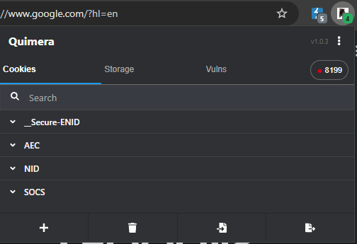
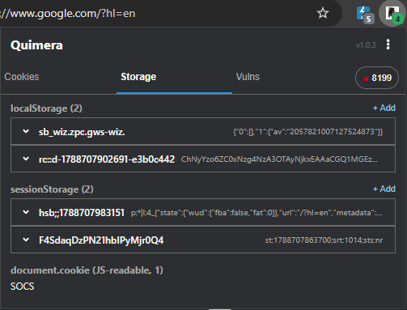
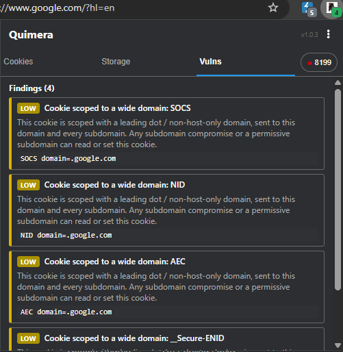
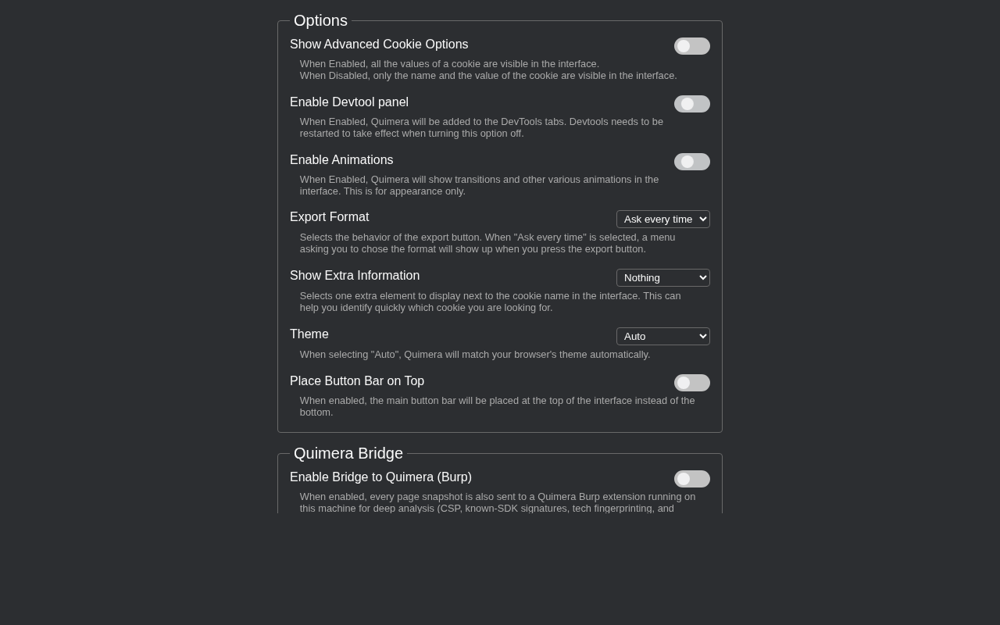
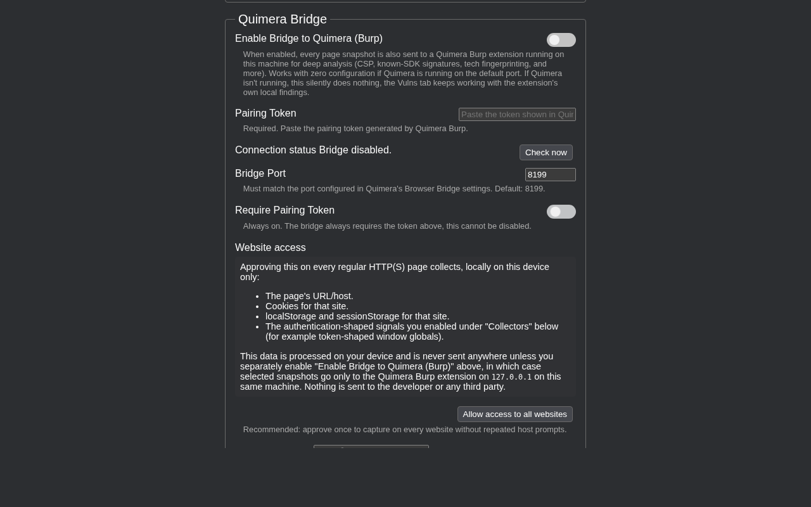
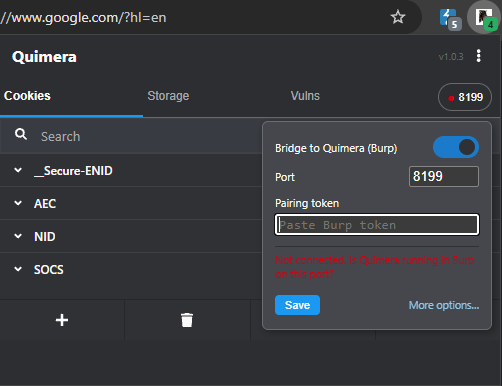
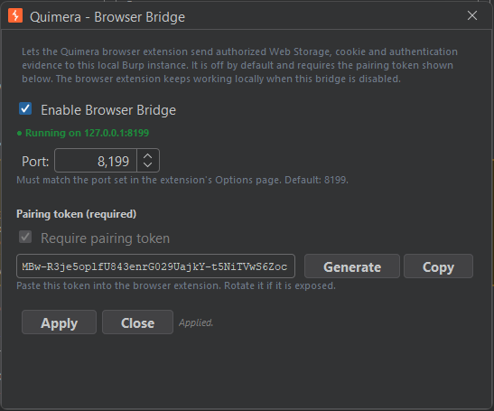
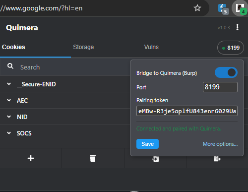

<div align="center">

<picture>
  <source media="(prefers-color-scheme: dark)" srcset="readme/quimera-logo-card.png">
  
</picture>

# Quimera

**A cookie manager that also watches your own browser for the things a proxy can never see.**

[](LICENSE)
[](manifest.chrome.json)
[](#installing-unpacked-for-personal-use)

</div>

---

## The problem with proxies

Burp, ZAP, mitmproxy, any of them, only ever see what crosses the wire. None of them see the token a
single-page app quietly wrote to `localStorage` after the response was already rendered. None of them
see a cookie that claims `HttpOnly` in one response but is actually readable from `document.cookie`
because someone else set it without that flag somewhere else in the app. None of them see an OIDC
token response an auth library buried three levels deep inside a JSON blob under one innocuous key.

Quimera is a full cookie manager first, so you never lose that daily tool, and a small vulnerability
engine that runs inside the page itself second, so it catches exactly what response-body analysis has
to guess at.

## Take a look around

<table>
<tr>
<td align="center"><br><sub>Cookies</sub></td>
<td align="center"><br><sub>Storage</sub></td>
<td align="center"><br><sub>Vulns</sub></td>
</tr>
</table>

Three tabs, one popup.

**Cookies** is the part inherited from Cookie-Editor: create, edit, delete, full attribute control
(Secure, HttpOnly*, SameSite, Domain, Path, Expiration), import and export as JSON, header string, or
Netscape cookie-file format, from the popup, a side panel, or DevTools, whichever fits how you work.

*(Cookies actually marked `HttpOnly` can't be read or written by any extension. That's the browser
protecting you, not a Quimera limitation.)*

**Storage** shows the real, live `localStorage` and `sessionStorage` of the page you're on right now,
not a guess reconstructed from an HTTP response body. If it's in the page, you see it.

**Vulns** is where the engine runs. Entirely inside the browser, no server involved, flagging:

- Real secrets and JWTs sitting in Web Storage or in credential-shaped `window` globals.
- Cookies that are actually readable by JavaScript despite the site claiming `HttpOnly` somewhere else.
- Storage values that are themselves a JSON blob get walked recursively, not just checked flat.
  `angular-auth-oidc-client`, `oidc-client-ts`, MSAL and similar OIDC libraries store the entire token
  response, access, refresh and id token included, as one JSON string under a single key. Neither the
  key's name nor the raw value look like a token on their own. Quimera still finds it.
- Severity that accounts for where a value actually lives: `localStorage` (permanent, readable by any
  future XSS at leisure) scores higher than `sessionStorage` (gone the moment the tab closes).

Deliberately scoped to headers, cookies and auth. Generic DOM-secret scanning, insecure-form scanning
and postMessage origin checks were all tried and pulled back out, see `content/engine.js`'s own
comments for what and why.

## Options, laid out plainly

<p align="center">

</p>

Everything that changes how Quimera behaves lives on one page: advanced cookie fields, the DevTools
panel toggle, animations, export format, theme. Nothing hidden three menus deep.

<p align="center">

</p>

Further down is the part that matters most for privacy: exactly what a granted host collects (the
page's URL, its cookies, its storage, whichever auth-shaped signals you've opted into) spelled out in
plain language, right next to the switch that turns it on.

## Bridge to Quimera for Burp (optional)

When the [Quimera Burp extension](https://github.com/B3XAL/Quimera) is running on the same machine,
every page snapshot can also be sent to it over a local loopback connection for deeper analysis: CSP,
known auth-SDK signatures, tech fingerprinting. It only flows one way on purpose, whatever
Quimera-burp's own analysis turns up shows up in *its* Logger and Issues, not mirrored back into this
extension. The Vulns tab only ever shows what this extension itself detected.

Off by default. Pairing takes three steps: enable the bridge in Burp, copy the token it generates,
paste it into Options here. Leave it disabled and the extension keeps working exactly as it did
before, fully standalone.

## Pairing, step by step

Both sides start off. Getting them talking takes about a minute. One prerequisite: [Quimera for Burp
Suite](https://github.com/B3XAL/Quimera) is loaded and running.

<p align="center">

</p>

**1. Open the bridge widget.** Click the Quimera icon, then the bridge toggle in the popup (Options
has the same setting, either place works). Right now it has nowhere to connect to yet, that's
expected.

<p align="center">

</p>

**2. Generate a token in Burp.** Open the **Quimera** tab in Burp, then **Settings**, then **Browser
Bridge...**. Check **Enable Browser Bridge**, leave the port at its default `8199` unless something
else on your machine already uses it, click **Generate**, then **Copy**. Click **Apply**, the status
line should switch to "Running on 127.0.0.1:8199".

<p align="center">

</p>

**3. Paste it back into the extension.** Same widget as step one, paste the token, save. "Connected
and paired with Quimera" in green means it worked. If it doesn't, see Troubleshooting below.

**4. Give it something to actually see.** Pairing alone doesn't collect anything yet, the extension
still needs permission to read a given site, same as any browser extension. Simplest: **Allow access
to all websites** in Options. More conservative: list specific hosts under **Authorized hosts**. Or
turn on **Synchronize Burp Target Scope** and let it offer hosts Quimera has already seen in Burp
traffic as candidates.

**5. Confirm it landed.** Browse a page you've authorized. In Burp's **Quimera** tab, findings sourced
from the browser (real storage or cookie values, auth-shaped `window` globals) start showing up
marked as browser-sourced. If a page's host isn't in Burp's Target Scope, the bridge silently drops
what the browser sent for it. By design, not a bug.

### Troubleshooting

| Symptom | Likely cause |
|---|---|
| "Not connected (Quimera not running, or bridge disabled/blocked)" | Burp isn't running, "Enable Browser Bridge" is unchecked, or its status line says "Failed to start" (port already in use, e.g. two Burp instances). |
| "Paste the pairing token shown by the Quimera Burp extension first" | The Pairing Token field is empty or under 32 characters. Go back to Burp's dialog and click Copy again. |
| Connected, but nothing shows up in Burp | Check step 4 (host permission) and confirm the page's host is actually in Burp's Target Scope. |
| It worked, then stopped | The token was probably regenerated in Burp, rotating it invalidates the old one immediately. Copy the new one into Options. |
| Port fields don't agree | The Port value in Burp's dialog and the Bridge Port in the extension's Options must be identical. |

## Installing (unpacked, for personal use)

**Chrome / Edge / Brave / Opera:**
1. Open `chrome://extensions` (or `edge://extensions`, `opera://extensions`).
2. Turn on Developer mode, top right.
3. Click "Load unpacked" and select this folder.
4. If the browser doesn't pick up the manifest automatically, copy the browser-specific one
   (`manifest.chrome.json`, `manifest.edge.json`, `manifest.opera.json`) to `manifest.json` first,
   some Chromium builds require that exact filename.

**Firefox:**
1. Open `about:debugging#/runtime/this-firefox`.
2. Click "Load Temporary Add-on..." and select `manifest.firefox.json` (or a copy named
   `manifest.json`).
3. Temporary add-ons disappear on restart, reload from `about:debugging` again, or package it
   properly for a permanent install.

**Safari:** the native wrapper lives in `safari/Quimera/`, an Xcode project. Open it, set your own
Apple Developer Team under Signing & Capabilities (none is configured by default), run
`npm run build:safari`, then build the wrapper in Xcode.

Host access is opt-in everywhere. Add only the hosts you're actually testing in Options, an empty
list means no page capture, and you can revoke access at any time from your browser's own settings.

## Testing the vulnerability engine

Open `test/seed.html` with the extension installed (serve it, `python3 -m http.server` from `test/`
works fine, it needs a real HTTP origin), then open the Vulns tab. It seeds one example of every check
still in scope: a JWT with `alg:none`, a JWT with no `exp`, an opaque token in Web Storage and in a
window global.

## Building from source

```bash
npm ci
npm test
npm run lint
npm run build          # builds targets into build/<browser>/ and store ZIPs into dist/<version>/
npm run build:safari   # Safari target only, feeds the Xcode project in safari/Quimera/
```

## Architecture

```
content/            content scripts: DOM/window-global collection (content.js, inject-mainworld.js,
                     mainworld-loader.js) and the client-side vulnerability engine (engine.js)
interface/lib/       shared background-script libraries: browser detection, permission handling,
                     Netscape-format cookie import/export
interface/lib/quimera/  Quimera-specific additions: the Burp bridge client, shared constants, cookie
                     checks
interface/popup/    the popup UI, including quimera-tabs.js (Storage/Vulns tab wiring on top of
                     Cookie-Editor's own cookie-list UI)
interface/options/  the Options page (bridge port/token, host scoping, collector toggles, About)
interface/devtools/ the DevTools panel variant of the same UI
interface/sidepanel/ the side-panel variant of the same UI
safari/Quimera/     the native Safari wrapper app (Xcode project)
```

## Where this came from

Quimera started as a fork of [Cookie-Editor](https://cookie-editor.com/), still fully GPL-3.0, still
crediting its original author, because the cookie-jar engine underneath it (fast, already handles
every browser's quirks) didn't need reinventing. What got added on top is the part a cookie editor was
never meant to do: read the page's actual runtime state, the way an attacker's own injected script
would, and flag what's actually reachable instead of what merely looks suspicious in a name.

Cookie-Editor by Christophe Gagnier is a separate, independently published extension, available on the
Chrome Web Store, Firefox Add-ons, the App Store, Microsoft Store and Opera Add-ons, see its own site
for those links. This fork isn't published on any of them.

## Feature suggestions or bug reports

[Find me on GitHub](https://github.com/B3XAL).

## License

GPL-3.0, see [`LICENSE`](LICENSE). Use it, fork it, modify it, just keep it open: any distributed fork
or derivative must stay GPL-3.0, credit Cookie-Editor as the base it's built on, and make its source
available.
